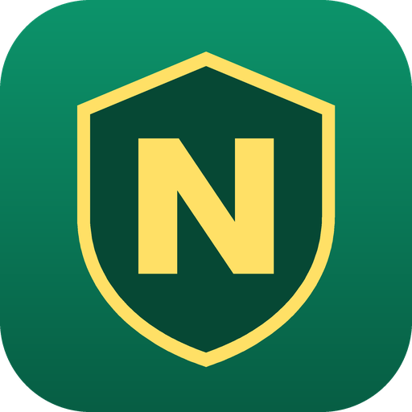

# 🛡️ نرسیس گیت‌وی (Narcic Gateway)

**کلاینت پیشرفته، فوق‌العاده سریع و چند‌هسته‌ای فیلترشکن و تونل امن برای اندروید**  
*طراحی شده برای دسترسی آزاد، پایدار و ایمن به اینترنت آزاد و بدون سانسور.*

[**English Documentation (مستندات انگلیسی)**](README.md) • [**دانلود آخرین نسخه APK**](https://github.com/valid7996/Narcic-Getway/releases/latest) • [**گزارش مشکل / باگ**](https://github.com/valid7996/Narcic-Getway/issues)

---

## ⚡ معرفی برنامه

**نرسیس گیت‌وی (Narcic Gateway)** یک کلاینت مدرن، سبک و بسیار قدرتمند است که به‌طور ویژه جهت عبور از سیستم‌های پیشرفته فیلترینگ (DPI) و محدودیت‌های شدید اینترنت توسعه یافته است. این برنامه با تلفیق پروتکل‌های رمزنگاری نسل جدید، قابلیت‌های هوشمند سوئیچ خودکار بین سرورها و رابط کاربری اختصاصی بر پایه Jetpack Compose Multiplatform، تجربه‌ای امن، پرسرعت و پایدار را برای شما فراهم می‌کند.

---

## ✨ امکانات و قابلیت‌های برجسته

- 🚀 **موتور چند‌هسته‌ای یکپارچه:** پشتیبانی همزمان از Xray-core، Sing-box، تونل‌های Psiphon، Aether، شبکه Tor و WireGuard.
- 🔗 **اسکیمای اختصاصی `narcicgeteway://`:** دریافت و ارسال فوری لینک‌های اشتراک و کانفیگ‌ها با یک کلیک در برنامه‌های پیام‌رسان و وب‌سایت‌ها.
- 🗺️ **نقشه تعاملی مسیر اتصال و کشورها:** نمایش زنده مسیر ترافیک، کشور مبدا و مقصد، پینگ دقیق و جزئیات IP.
- 🛰️ **سیستم رادار سایبری (Cyber Radar):** تست پینگ لحظه‌ای، پایش سلامت سرورها و سوئیچ خودکار به سریع‌ترین نود متصل.
- 🔒 **بخش گاوصندوق رمزنگاری‌شده (Vault .zsx):** اشتراک‌گذاری امن و ذخیره‌سازی کانفیگ‌ها با الگوریتم‌های استاندارد رمزنگاری بدون افشای سورس.
- 🎨 **طراحی مدرن و تم‌های پویا (Liquid UI):** رابط کاربری سازگار با استانداردهای Material 3، پشتیبانی کامل از حالت تاریک (Dark Mode) و مشکی آمولد (AMOLED Black).
- 🛡️ **فیلترشکن به تفکیک برنامه (Per-App Proxy):** مدیریت اختصاصی مسیر ترافیک اپلیکیشن‌ها و معاف کردن برنامه‌های بانکی و داخلی.

---

## 🛠️ پروتکل‌های پشتیبانی‌شده

| پروتکل / هسته | ویژگی‌ها و انواع انتقال (Transports) |
|:---|:---|
| **V2Ray / Xray** | VLESS، VMess، Trojan، Shadowsocks با مدهای (`TCP`، `WS`، `gRPC`، `HTTPUpgrade`، `REALITY`) |
| **Aether** | WireGuard over MASQUE، اتصال دوگانه WARP-in-WARP (`gool`)، اسکن خودکار و پروب تاخیر |
| **Hysteria 2 (hy2)** | پروتکل پرسرعت ضد‌فیلتر بر پایه پروتکل UDP و QUIC (HTTP/3) |
| **Psiphon (سایفون)** | تونل فرانتینگ چندمسیره برای دور زدن محدودیت‌های سراسری |
| **Tor & پل‌ها** | مسیریابی لایه‌ای تور، پل‌های Snowflake، obfs4 و ترنسپورت‌های Conjure |
| **WireGuard / AWG** | تونل‌های استاندارد WireGuard و نسخه ضدانسداد AmneziaWG |
| **تونل‌های DNS** | DNSTT، VayDNS و MasterDNS جهت اتصال در مواقع قطعی سراسری TCP/UDP |
| **OpenConnect و IKEv2** | تونل‌های تجاری Cisco AnyConnect و استانداردهای پروتکل بومی IPSec |

---

## 📲 راهنمای دانلود و نصب

۱. به بخش **[Releases (انتشارها)](https://github.com/valid7996/Narcic-Getway/releases/latest)** مراجعه کنید.  
۲. فایل نصبی متناسب با سیستم‌عامل خود را دریافت نمایید:  
   - **اندروید:** فایل‌های APK (`arm64-v8a`، `armeabi-v7a`، `x86_64`، `universal` و نسخه‌های تمیز `-clean`).  
   - **ویندوز:** فایل نصبی `NarcicGetway-*-x86_64.msi` یا نسخه قابل حمل `NarcicGetway-*-windows-x86_64.zip`.  
   - **لینوکس و مک:** فایل‌های `.deb`، `.rpm`، `.AppImage` و `.dmg`.  
۳. برنامه را نصب کرده و لینک اشتراک یا کانفیگ خود را از طریق:
   - کلیک روی لینک‌های `narcicgeteway://...`
   - دکمه وارد کردن از کلیپ‌بورد (Clipboard)
   - اسکن بارکد QR  
   وارد نمایید.  
۴. دکمه **اتصال (Connect)** را لمس کرده و با امنیت کامل از اینترنت آزاد لذت ببرید!

---

## 🤝 توسعه‌دهندگان و تشکر

- **توسعه‌دهنده و سازنده:** [رابین هود / Rabin Hood (valid7996)](https://github.com/valid7996)
- **کانال رسمی تلگرام:** [@Narcic_team](https://t.me/Narcic_team)

---

## 📜 مجوز (License)

این پروژه تحت مجوز آزاد **GNU General Public License v3.0** منتشر شده است. هسته‌های مورد استفاده بر اساس مجوزهای رسمی خود (GPLv3، LGPLv3، MPL 2.0) ارائه گردیده‌اند.
